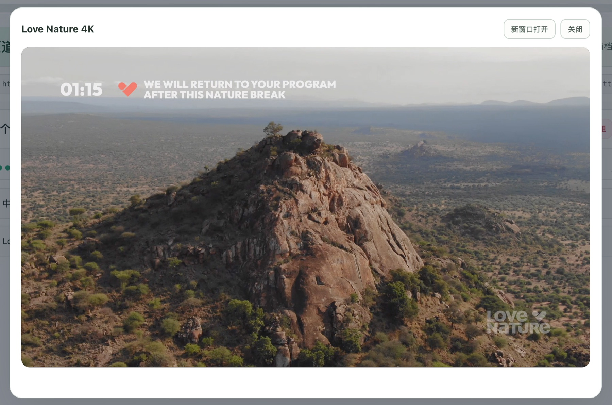
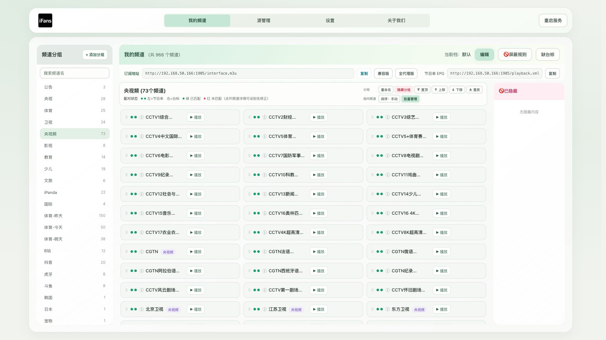
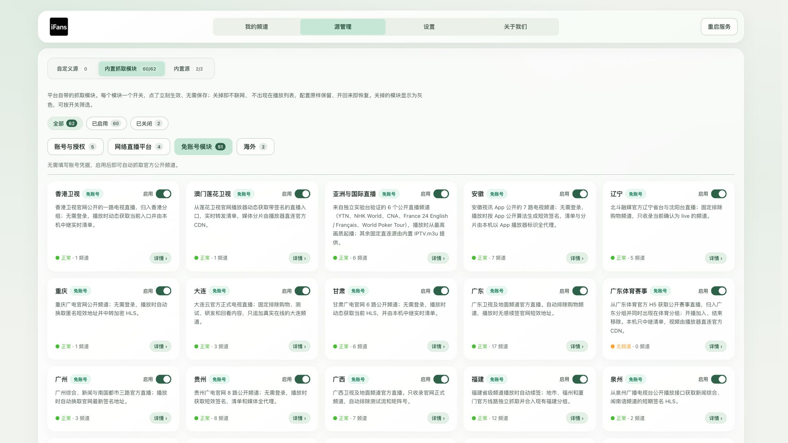

<div align="center">

# 📺 iPTV

### 把分散的直播源，变成一套真正属于你的频道系统

自托管 · 模块化 · 可视化 · NAS 友好

[](https://github.com/akiralereal/iptv/stargazers)
[](https://hub.docker.com/r/akiralereal/iptv)
[](LICENSE)
[](https://github.com/sponsors/akiralereal)

[](https://t.me/iFansClub)
[](https://t.me/iFansClubChat)

### [🐳 Docker 部署教程](#-快速开始) · [前往 Docker Hub →](https://hub.docker.com/r/akiralereal/iptv)

推荐通过 Docker 在 NAS / 服务器上部署，镜像：`akiralereal/iptv:latest`

**当前版本：v4.40.0** · [产品预览](#-产品预览) · [频道覆盖](#-频道覆盖) · [内容来源](#-内容来源与抓取能力) · [功能说明](#-功能全景) · [更新日志](CHANGELOG.md)

</div>

iPTV 是一个面向家庭影音与 NAS 用户的**模块化 IPTV 直播源管理与分发系统**。它内置央视频、咪咕、B站、抖音、虎牙、斗鱼及多地区广电等抓取模块，也能接入需要网页解析的内置源、维护者筛选的公开独立源、自定义直连地址和 M3U/TXT 订阅；所有来源统一完成聚合、去重、编排，再输出干净的播放列表与 EPG 节目单。

项目更新和社区公告请订阅 [Telegram 公告频道（@iFansClub）](https://t.me/iFansClub)；使用问题、反馈和心得交流，欢迎加入 [Telegram 用户交流群（@iFansClubChat）](https://t.me/iFansClubChat)。Bug 反馈和功能建议也可以提交 [GitHub Issue](https://github.com/akiralereal/iptv/issues)。

> [!IMPORTANT]
> 本项目是自托管的软件工具。除项目自制的使用公告短片外，不托管第三方音视频节目；仓库及运行时可能整理互联网上公开可访问的播放地址与频道元数据，但“公开可访问”**不代表内容属于公有领域，也不代表已获得复制、转播或商业使用授权**。请仅在获得合法授权的范围内使用；如你是权利人并认为相关条目侵权，请按[版权与侵权处理](#-版权与侵权处理)提交下架通知。

## 🖼️ 产品预览

<p align="center"><b>网页播放实况 · 在管理台直接预览频道</b></p>
<p align="center"></p>

<p align="center"><b>我的频道 · 所有频道一处编排</b></p>
<p align="center"></p>

<p align="center"><b>源管理 · 每个内容来源独立、透明、可控</b></p>
<p align="center"></p>

## ✨ 为什么选择 iPTV

| 📺 开箱即用 | 🧩 模块化源管理 | 🪄 可视化编排 |
| --- | --- | --- |
| 默认聚合 800+ 频道，其中央视频模块提供 63 个公开高清频道及 10 个本人账号可访问的会员频道，另有 B站、抖音、虎牙、斗鱼直播抓取和经筛选的公开独立源 | 央视频、咪咕、B站、抖音、虎牙、斗鱼及各广电抓取模块都有独立开关、配置和健康状态，按需启用，互不干扰 | 分组、排序、重命名、隐藏与批量管理，都在浏览器中完成 |
| 🔗 **自由接入** | 📡 **稳定分发** | 👨‍👩‍👧‍👦 **多端共享** |
| 支持 M3U8 直链、网页自动提取，以及 M3U/M3U8/TXT 订阅批量导入 | 自动生成 M3U、TXT 与 EPG；提供兼容版、全代理版应对特殊播放器 | 多配置档与用户令牌，让每台电视、每位用户拥有自己的频道组合 |

> [!TIP]
> 默认配置即可使用免费频道；需要更高画质时，再到「源管理」为对应平台配置你本人合法持有的账号。凭据只保存在自己的部署中。

## 📡 频道覆盖

默认部署目前可聚合 **800+ 频道**，并会随着平台模块、赛事内容和精选频道持续扩展。实际数量会因平台接口状态、地区网络和启用的模块而动态变化。

| 范围 | 当前覆盖内容 |
| --- | --- |
| **央视频直播** | **63 个免登录公开频道 + 10 个本人账号可访问的会员频道**；公开台覆盖央视全套、CGTN 多语种和全国主要省级卫视，统一归入「央视频」分组 |
| **iPanda 直播** | **22 路免登录公开直播**：成都与都江堰 2 个 24 小时总频道、18 个熊猫固定机位，以及江苏大丰麋鹿、云南白马雪山 2 路珍稀动物直播，统一归入「iPanda」分组 |
| **央视与卫视** | CCTV 系列、CGTN、全国主要卫视频道 |
| **地方频道** | 北京、天津、重庆、四川（含成都及区县）、贵州、安徽、广东（含广州、深圳、梅州、江门）、广西、福建（含泉州、晋江、石狮、德化、莆田、宁德）、江西、甘肃、青海（含西宁）、新疆、西藏、云南、吉林、黑龙江、内蒙古、宁夏、海南、河北、山西、陕西、湖北、辽宁（含沈阳、大连）、浙江（含杭州、宁波、嘉兴、台州天台、绍兴）、江苏（含南京、苏州、无锡、扬州、南通）、山东（含青岛）、河南、上海、湖南等省市卫视与地面频道，并持续接入更多地区 |
| **景观直播** | 央视网「直播中国」当前在线信号，以及吉林风景、美丽河北、Live 南京、青岛城市直播、上海慢直播等景观频道；数量随平台在线状态动态变化 |
| **体育赛事** | 体育频道、赛事直播，以及昨天 / 今天 / 明天的动态赛事频道；广东体育官方公开赛事按“广东体育 · 赛事名称”显示在「广东」分组并同时出现在「体育」分组，数量随开播与结束变化 |
| **亚太与国际** | 精选列表提供 15 个经实验台验证的固定直连频道；独立模块另提供 YTN、NHK World 两个需要动态解析的公开频道，以及香港卫视、澳门莲花卫视两路官网直播；另有「海外频道」模块的 33 个海外免费频道、「澳门」模块的澳广视自办 6 套电视，默认关闭，需要时在后台打开 |
| **综合内容** | 影视、文旅、教育、少儿、娱乐时尚等分类频道 |

播放列表首位默认提供项目自有的「公告」分组，内含三条自制短片：“欢迎使用 iPTV for iFansClub.com”展示使用方式、版权提醒和侵权联系说明；“央视频会员频道登录教程”演示 Docker / NAS 用户如何从浏览器复制 Cookie 把央视频登录态导入 iPTV；“「来源于网络」频道添加教程”演示如何在后台「🌐 源管理 → 👤 自定义源」用「🌏 添加「来源于网络」列表」卡片一键订阅仓库 `from-the-web/from-the-web.m3u` 里的网络第三方源。三者都不引用任何第三方节目素材。不想在电视上显示可以在后台「我的频道」逐条隐藏（随时可在「已隐藏」里恢复）；只要显示，该分组就固定在第一位，不支持删除、移动、排序或重命名。

## 🧩 内容来源与抓取能力

iPTV 的重点不只是一份静态频道表，而是一套可独立开关、可观察状态、可持续刷新的内容接入体系。不同来源采用不同刷新、鉴权与代理策略，平台临时不可达时可在源管理中查看状态或关闭对应模块。

| 来源类型 | 已支持的典型内容 | 工作方式 |
| --- | --- | --- |
| **央视频直播** | **63 个公开频道 + 10 个需登录/VIP 的频道** | 公开频道继续匿名动态取票、自动切换备用 CDN；会员频道复用部署者本人在央视频站点的持久登录态，由网页播放器签发并解扰成本机 H.264/AAC fMP4 HLS，解决普通播放器直接拿会员流时“有声无画”。桌面本机可从源管理自动打开登录窗口；Docker / NAS 等没有桌面的部署从自己电脑浏览器的开发者工具里复制整段 Cookie 导入（会话 cookie 是 HttpOnly，书签工具拿不到），服务端之后自动续期 |
| **iPanda 直播** | 成都、都江堰共 20 路熊猫直播，以及江苏大丰麋鹿、云南白马雪山 2 路珍稀动物直播 | **无需登录、无需配置**；18 路固定机位使用支持网页直连的上游 CDN，2 个总频道和 2 路珍稀动物直播在播放时检查公开状态并自动切换上游 CDN，清单与媒体由本机安全代理。最高均为真实 720p，即平台所称“超清” |
| **平台直播抓取** | **B站、抖音、虎牙、斗鱼** | 可按分类自动收录当前直播间，也可手动指定房间；播放时处理短效地址、画质选择和平台要求的请求头。B站支持扫码登录以使用本人账号可访问的画质，抖音、虎牙、斗鱼支持匿名公开直播。抖音默认从「聊天」「生活」两个分类轮选 20 个、FLV 播放，分类和数量可在源管理里改，也可切换为公开网页「全部」页原始顺序（首批约 15 个）或 HLS；频道归入「抖音」，排在「B站」之后 |
| **电视与赛事平台** | 咪咕、体育赛事 | 自动整理频道与节目单，并按账号权限、设备兼容性和平台接口状态选择可用画质；需要登录的能力仅使用部署者本人提供的凭据 |
| **广东体育官方赛事** | 官方「广东体育频道plus」「广东体育频道」当前公开在播的赛事，归入 **广东**，同时出现在 **体育**（赛事名带少儿、卡通、动漫的改放「少儿」，带教育、科教的改放「教育」） | **无需登录、无需配置**；从广东体育官方 H5 动态发现赛事，播放时复核官方状态并读取 HLS；本机只中继清单，视频分片由播放器直连官方 CDN（不看来源头、不带签名），也可用 `?relay=2` 全代理。每场赛事独立标识，开播加入、结束移除；源管理有独立开关。广东体育电视频道仍由荔枝网模块提供 |
| **凤凰卫视** | **凤凰资讯、凤凰中文、凤凰香港**，归入 **香港** | 仅三个电视直播频道；游客 480p，登录普通凤凰秀账号可获取 **720p / 25 帧，无需付费会员**。后台支持导入 Token / Cookie 并持久保存，播放时取新签名，原始 HTTP-FLV 由本机转发。内置精选列表里的三条第三方凤凰线路同在「香港」，与本模块三台并列保留作备用线路，不合并、不顶替；播放器按名聚合时本模块源排在前面 |
| **香港卫视** | 香港卫视一路电视直播，归入 **香港** | **无需登录、无需配置**；播放时先问源站当前在播的是哪一路，再换这一路的 HLS 入口。服务端把入口清单拍平成媒体清单后只中继清单，媒体分片由播放器直连上游 CDN。实测为 1280×720、H.264/AAC；节目单取自官网节目单接口（今明两天） |
| **澳门（澳广视）** | 澳广视自办的 6 套电视：澳视澳门、澳视葡文、澳门体育、澳门资讯、澳门综艺、澳门-Macau，归入 **澳门** | **无需登录、无需配置**；播放时向官网的路由接口取当前网络可用的 CDN（缓存五分钟），播放器直连官方 CDN；官网与视频**只对大陆以外开放**，部署服务的机器（查 CDN）和播放设备（取视频）都要能连到大陆以外；**默认关闭**，需要时在后台打开；台标与节目单取自官网 |
| **澳门莲花卫视** | 澳门莲花卫视一路电视直播，归入 **澳门** | **无需登录、无需配置**；播放时从官网直播页的播放器配置读出当前带签名的 HLS 入口，入口在本机缓存五分钟、签名失效立即重读官网，每次播放都检查实时清单。服务端只中继清单，带独立签名的媒体分片由播放器直连上游 CDN，需要时也可用 `?relay=2` 全代理；台标与节目单取自官网 |
| **北京广播电视台** | 北京卫视、BRTV 文艺 / 纪实科教 / 影视 / 财经 / 体育休闲 / i生活 / 新闻、卡酷少儿，以及北京时间当前公开活动或慢直播 | 公开直播免登录并自动排除失效项目；9 个电视频道需在后台导入本人北京时间 Cookie。凭据仅用于取流接口，不写入订阅、不发送到媒体 CDN；清单和分片由本机补齐防盗链请求头并代理 |
| **重庆广电** | 源站当前公开的 CQTV新闻 | **无需登录、无需配置**；频道表自动同步，播放时匿名换取短效 HLS，清单、AES 密钥和媒体分片由本机全代理 |
| **四川广电** | 四川卫视、新闻、经济、文化旅游、影视文艺、妇女儿童、四川乡村、康巴卫视、四川卫视 4K 超高清 SDR，以及源站当前公开活动直播 | 活动直播有则显示、无则隐藏且无需登录；9 个固定电视台需使用部署者本人的四川源站登录态。后台提供书签工具读取源站 Token，服务端播放时动态换取短效地址，清单、密钥和媒体分片均补齐源站防盗链请求头并全代理 |
| **成都广电** | 成都新闻综合、经济资讯、都市生活、影视文艺、公共、少儿、蓉城先锋及 20 路区县电视，共 27 路，归入 **四川** | **无需登录、无需配置**；播放时从看度官方 App 接口获取签名地址，主频道优先高清，默认 302 跳转、播放器直连，不转码、不常驻浏览器。龙泉旧源不可用，暂不收录。新闻综合、公共带今明两天的央视网官方节目单，其余暂无；24 路使用官网新版图床的频道台标，3 路由内置台标包补齐（含资料库出处），不提供回看 |
| **江西广电** | 江西卫视、都市、经济生活、公共农业、少儿、新闻、移动电视、陶瓷共 8 路 | **无需登录、无需配置**；源站当前公开的是单档 720p，服务端按源站公开算法获取匿名短效 token，并在播放器每次轮询时重新拉取滚动清单；清单、密钥和媒体分片均补齐防盗链请求头并全代理 |
| **贵州广电** | 贵州卫视、公共、影视文艺、大众生活、生态乡村、科教健康、经济、移动电视共 8 路 | **无需登录、无需配置**；播放时从源站公开 API 获取当前短效签名地址，播放器每次轮询重新拉取只有三个 3 秒分片的滚动清单，清单和媒体全代理；家有购物明确不纳入频道表 |
| **甘肃广电** | 甘肃卫视、文化影视、移动电视、少儿、科教、公共应急共 6 路 | **无需登录、无需配置**；播放时从源站公开接口动态获取当前入口，每次轮询重新拉取滚动清单并中继给播放器，视频分片由播放器直连上游 CDN；入口轮换或接口短时抖动会自动重试和兜底 |
| **黑龙江广电** | 黑龙江卫视、都市、新闻法治、文体、少儿、影视、农业科教共 7 路 | **无需登录、无需配置**；极光新闻 App 在用的官方入口，地址固定、不带签名，上游既不校验来源也不挑播放器标识，因此频道直接给直链，由播放器直连官方 CDN，本机不转发媒体。官方业务域名走 4430 端口而非 443。实测 7 路均为 1280×720、H.264 / AAC-LC，25 帧 |
| **云南广电** | 云视网云南卫视、都市、康旅、澜湄国际，以及七彩云端临沧、怒江、昭通共 7 路，统一归入 **云南** | **无需登录、无需配置**；省级四路由官网接口按「当前这档节目」签发 DVR 窗口地址，签名按路径签、无法预取，播放时重新换取，节目换档后下一次解析自然接上（分片序号连续，实测跨档不断流）；地方三路按七彩云端目录取当前在线机位。两家回源要求不同，省级必须带官网来源头、地方不需要，清单与分片均由本机全代理。省级实测 1280×720 / 25 帧，地方分别为 720p25、1080p50 与 720×416 |
| **山西广电** | 山西卫视、黄河电视台、经济与科技、影视、社会与法治、文体生活 6 路省级频道，以及太原、朔州、忻州、阳泉、吕梁、晋中、长治、晋城、临汾、运城 10 路地市频道，共 16 路，统一归入 **山西** | **无需登录、无需配置**；省级频道的播放路径按官网播放器算法由「频道码 + 当天日期」算出，只认当天、零点即换，播放时按上海时区重算；地市频道播放前向官网签名接口换取短效地址。两家 CDN 都不校验来源与播放器标识，本机只中继清单，媒体分片由播放器直连官方 CDN，也可用全代理订阅。实测 16 路均为 1280×720、H.264 / AAC-LC，25 帧；节目单取自官网逐台节目单接口（今明两天），省级 6 路与太原、晋中、临汾有，另外 7 个地市台官方为空 |
| **陕西广电** | 陕西卫视、新闻资讯、都市青春、银龄、秦腔、体育休闲、农林卫视、移动电视共 8 路，统一归入 **陕西** | **无需登录、无需配置**；播放时现解官网看电视页下发的加密频道目录取当前地址——地址不带签名，但官网会整批换名、旧名立即失效，所以不写进播放列表；CDN 不校验来源与播放器标识，本机只中继清单，媒体分片由播放器直连官方 CDN（仅 HTTP），也可用全代理订阅。实测 8 路均为 720×404、H.264 / AAC-LC，25 帧（官网只有这一档）；8 路都有官网当天节目单 |
| **西藏广电** | 西藏卫视、藏语卫视、影视文化共 3 路，统一归入 **西藏** | **无需登录、无需配置**；播放时从「珠峰云」App 的频道接口取当前带签名的 HLS 地址（签名只验清单，签发一小时后仍有效），频道表五分钟复用一次，清单被拒时立即重取。CDN 不校验来源与播放器标识、分片不带签名，本机只中继清单，媒体分片由播放器直连官方 CDN，也可用全代理订阅。实测 3 路均为 1920×1080、H.264 / AAC-LC，25 帧；官方没有节目单，西藏卫视与央视频同名，开着央视频时共用其节目单 |
| **天津广电** | 天津卫视、天津新闻、天津文艺、天津影视、天津都市、天津体育、天津教育 7 路，统一归入 **天津** | **无需登录、无需配置**；按津云 App 的 WiseTV 协议在播放时签发短效地址（App 内置应用参数，可用环境变量覆盖），签发接口每次在腾讯、网宿、百度三家 CDN 间轮换。网宿的播放会话绑定取清单那一方的播放器标识，播放器直连分片会被拒，所以清单与分片都经本机全代理；播放中直接轮询官方媒体清单，跨过 10 分钟的签名有效期也不断流、不换 CDN。台标用津云 App 的频道图标。实测 7 路均为 1280×720、H.264 High / AAC-LC，25 帧；节目单取自津云官方接口（今天、明天） |
| **青海广电** | 青海卫视、青海经济生活、青海都市、安多卫视共 4 路，归入 **青海** | **无需登录、无需配置**；前三路取自长云网（青海广播电视台官网）的云直播，安多卫视取自青海藏语网络广播电视台官网，两家同一平台。播放时向频道接口换取带签名的地址，签名标称两小时，本机半小时换一次；CDN 不校验来源与播放器标识，本机只中继清单，媒体分片由播放器直连官方 CDN，也可用全代理订阅。实测 4 路均为 1920×1080、H.264 / AAC，25 帧。官网、接口与 CDN 仅大陆网络可访问。青海卫视节目单取自央视网，另三路官方节目单只有整点占位，暂无节目单 |
| **宁夏广电** | 宁夏卫视、宁夏公共、宁夏文旅共 3 路，归入 **宁夏** | **无需登录、无需配置**；黄河云公开的官方直播入口，地址固定、不带签名，上游不校验来源也不挑播放器标识，播放器直连官方 CDN，本机不转发媒体；节目单取自黄河云官方接口（只有当天） |
| **嘉兴广电** | 嘉兴新闻综合、文化影视、公共频道共 3 路，归入 **浙江** | **无需登录、无需配置**；频道入口来自嘉兴在线「看电视」页，播放时按频道向趣看的公开播放接口换取签名 HLS，本机只中继实时清单，媒体分片由播放器直连上游 CDN，清单与分片都限定在该频道的官方域名和路径；也可用 `?relay=2` 全代理 |
| **台州（天台和合）** | 天台县和合频道 1 路，归入 **浙江** | **无需登录、无需配置**；入口来自和合天台 App，播放时向趣看公开接口获取签名 HLS，本机中继实时清单，视频分片直连官方 CDN，也可用 `?relay=2` 全代理；实测 1080p；台标取自官方频道卡正中的风车标，由内置台标库提供，暂无可用官方节目单 |
| **绍兴广电** | 绍兴新闻综合、绍兴公共、绍兴文化影视共 3 路，归入 **浙江** | **无需登录、无需配置**；来自绍兴网官方直播页，每次播放从官方频道及播控接口自动发现地址；域名、路径、签名或 CDN 跳转变化时重新验证实时 HLS 和 TS 分片，详情旧源失效时从官网目录重新识别频道，本机中继清单、分片直连官方 CDN，也可用 `?relay=2` 全代理；三路均为 720p，带各自官方台标和今明两天的官方节目单。保留官网实际下发的 HTTP(S) 地址，不关闭 TLS 校验；加密、分段 MP4 或独立音轨等媒体结构变化会明确提示需要适配 |
| **杭州广电** | 杭州综合、西湖明珠、杭州生活、杭州影视、杭州青少体育共 5 路，归入 **浙江** | **无需登录、无需配置**；播放时向葫芦网（杭州文广集团官网）的频道接口取 2 小时有效的签名地址，本机缓存到过期前半小时，签名被拒时立即重签。官方 CDN 的清单和分片都只认官网来源头，所以清单与分片由本机带来源头全代理；只放行该频道在官方 CDN 上的路径。台标取自官方频道接口。实测 5 路均为 1280×720、H.264 / AAC-LC，25 帧；官网节目表只有整点「精彩节目」占位，暂无节目单；频道接口只对大陆网络开放，部署在大陆以外（含香港）时取不到 |
| **宁波广电** | 宁波新闻综合、经济生活、都市文体、影视剧共 4 路，归入 **浙江** | **无需登录、无需配置**；按宁波广电网直播页播放器的流程（直播页 → 播放器配置 → 频道资料 → 官方签名接口）取 1 小时有效的签名地址，频道资料缓存 6 小时、签名缓存到过期前 15 分钟，签名被拒时立即重签。CDN 不看来源头，本机只中继清单，媒体分片由播放器直连官方 CDN；也可用 `?relay=2` 全代理（后台网页播放时自动走全代理）。实测 4 路均为 1280×720、H.264 / AAC-LC，25 帧；官网节目单是每周的图片，暂无节目单；签名接口只对大陆网络开放，部署在大陆以外（含香港）时取不到 |
| **江门广电** | 江门综合 1 路，归入 **广东** | **无需登录、无需配置**；按官网公开规则读取正式电视目录、按上海日期生成当天 HLS，清单与分片补齐官网来源头并由本机全代理，不转码。实测 720×406、25 帧、H.264/AAC；接入官方台标与今明两天节目单，保留具体剧名、集数，不提供回看；不收内部送流口及广播 |
| **梅州广电** | 梅州客家生活 1 路，归入 **广东** | **无需登录、无需配置**；梅州市广播电视台自有域名下的公开 HLS，地址固定、不带签名，播放器直连上游 CDN，本机不转发媒体 |
| **泉州广电** | 泉州新闻综合、泉州闽南语共 2 路，归入 **福建** | **无需登录、无需配置**；播放时向官网公开接口换取短期签名 HLS，两个签名接口都触发人机验证时改从官网另一个域名的播放页取地址；上游 CDN 拒绝部分播放器标识，清单与分片由本机以浏览器标识全代理；节目单取自官网播放页 |
| **晋江、石狮** | 晋江电视台、石狮新闻综合共 2 路，归入 **福建** | **无需登录、无需配置**；晋江市、石狮市融媒体中心官网直播用的 HLS，地址固定、不带签名，播放器直连官方 CDN；石狮节目单取自官网直播页，晋江官方目前只有占位 |
| **莆田广电** | 莆田新闻综合、莆田文旅生活、仙游电视台共 3 路，归入 **福建** | **无需登录、无需配置**；频道入口来自「莆田TV」App 与官网共用的频道接口，播放时取签名 HLS（约 2 小时 45 分有效，本机缓存到过期前半小时），本机只中继实时清单，媒体分片由播放器直连官方 CDN，清单与分片都限定在该频道的官方路径；节目单取自莆田TV 官方接口（一套、二套，仙游官方只有占位）；也可用 `?relay=2` 全代理 |
| **宁德广电** | 宁德新闻综合、宁德文化旅游共 2 路，归入 **福建** | **无需登录、无需配置**；每轮刷新向宁德台官方直播接口要一次 HLS 地址，地址固定、不带签名，播放器直连官方 CDN；2026-10 复测海外也能播；官方节目单只有占位，暂无节目单 |
| **无锡广电** | 无锡新闻综合、娱乐、都市资讯、生活、经济共 5 路，归入 **江苏** | **无需登录、无需配置**；频道入口来自无锡博报 App 的直播分享页，播放时取签名 HLS（约 2 小时有效，本机缓存到过期前半小时），本机只中继实时清单，媒体分片由播放器直连官方 CDN，清单与分片都限定在该频道的官方路径；节目单取自无锡博报官方接口；分享页只对大陆和香港开放，部署在其他海外地区时取不到；也可用 `?relay=2` 全代理 |
| **南通广电** | 南通新闻综合、南通社教、南通公共共 3 路，归入 **江苏** | **无需登录、无需配置**；从江海明珠网官方目录获取频道与台标，播放时核对当前节目和播出垫片，清单与分片由本机代理，不转码。电视剧、动画、录播及其他未开放时段提示不可播，频道仍保留；三套接入官方当天节目单，共用官网“南通 NEWS”台标并提供内置备份，无回看 |
| **扬州广电** | 扬州新闻、扬州民生，以及江都、邗江两个区台共 4 路，归入 **江苏** | **无需登录、无需配置**；扬州发布 App 直播用的 HLS，地址固定、不校验签名，播放器直连官方 CDN；节目单取自扬州发布官方接口 |
| **青岛广电** | 青岛新闻综合、生活服务、影视、都市、教育共 5 路（QTV-1 到 QTV-5），归入 **山东** | **无需登录、无需配置**；官网直播页的固定地址，分片带官网播放器自用的加密封装，普通播放器直连播不了，播放时由本机代理边下边解、整段转发（与广西同一做法），能不能看取决于部署机器的网络；节目单取自官网播放页接口（只有当天）；台标用官网台标并收进内置库；五四广场等城市景观在「青岛景观」模块 |
| **安徽广电** | 安徽卫视、经济生活、影视、公共、农业科教、综艺体育、国际频道共 7 路 | **无需登录、无需配置**；按「安徽视讯」App 的公开算法解出鉴权密钥并逐路生成两小时签名，播放器每次轮询都重新拉取滚动清单；上游 CDN 只放行 App 播放器标识，清单与分片均以 App 标识经本机全代理 |
| **新疆广电** | 新疆卫视、维吾尔语新闻综合、哈萨克语新闻综合、汉语综艺、维吾尔语影视、体育健康、少儿共 7 路 | **无需登录、无需配置**；播放时从丝路视听网当前 Nuxt 包静态解析当天公开签名配置，再调用源站接口签发约一小时有效的 HLS。服务端中继实时清单，媒体分片默认由播放器直连上游 CDN，也可用全代理订阅。某一路被源站重新标记禁播时只跳过那一路，其余照常 |
| **吉林广电** | 6 路省级频道、9 路地方台和 13 路慢直播，共 28 路 | **无需登录、无需配置**；常规电视归入「吉林」，慢直播归入「吉林风景」。省级频道和季节性景观在播放时从源站加密接口获取短效 HLS，固定地方台和固定景观使用已验证的 HTTPS 入口；清单、密钥和媒体分片均由本机全代理 |
| **内蒙古广电** | 内蒙古卫视、蒙古语卫视等 8 路自治区频道，以及 12 路盟市频道，共 20 路 | **无需登录、无需配置**；20 路全部归入唯一的「内蒙古」分组。播放时按奔腾融媒源站公开协议调用加密频道接口获取动态地址，并为清单、密钥和媒体分片补齐防盗链请求头后由本机全代理 |
| **亚洲与国际直播** | **6 个公开频道：YTN、NHK World、CNA、France 24 English / Français、World Poker Tour**；另有 **11 个固定直连频道**位于精选列表的独立标记区块 | YTN、NHK World 在播放时从平台接口获取当前 HLS，并由本机代理清单、密钥与媒体；CNA、France 24 English / Français、World Poker Tour 由本机转发一次主清单、把最高档挪到最前，视频由播放器直连官方 CDN，网速不够照常降档（France 24 官方只有 1080p、360p 两条单独的清单，模块拼成一份）；NHK 主清单同样最高档在前。固定频道使用实验台验证过的原始 HLS 地址，不经过该解析模块，避免重复和额外转发开销 |
| **海外频道** | **42 个海外免费频道**：体育 13（Sky Racing、FUEL TV、beIN Sports Xtra、FIFA+ 等）、娱乐时尚 12、文旅 7（含 NASA+、Gusto TV）、国际 9（NEWS1、France 24 Español、Thai PBS、Bloomberg TV 亚太 / 欧洲 / 美国、DW English、TRT World、Al Jazeera English）、韩国 1（Arirang），并入对应的现有分组、排在组尾 | 实验台验证过的固定直链，播放器直连各平台 CDN，无需登录；官方主清单把低档排在前面的 13 台（Thai PBS、DW English、TRT World、NASA+、Gusto TV、Arirang、FUEL TV、MTRSPT1、Terra Mater WILD、Wipeout Xtra、MovieSphere、FIFA+、Qello Concerts）由本机转发一次主清单、把最高档挪到最前（France 24 Español 官方只有两条单档清单，由本机拼成 1080p 在前的主清单），视频仍由播放器直连，本机取不到主清单时退回直连；在大陆常卡顿或连不上（Bloomberg、DW 在大陆连不上），**默认关闭**，在模块卡片上打开即可；服务端只给地址，能不能看取决于播放设备的网络（播放设备挂了代理，服务部署在大陆也能看）；频道表是仓库里的 `IPTV-overseas.m3u`，和精选列表一样每 6 小时从仓库更新、无需升级镜像；暂无节目单 |
| **广电抓取** | 北京、天津、重庆、四川（含成都及区县）、贵州、安徽、大连、广东、广西、福建、江西、甘肃、青海、新疆、西藏、云南、吉林、黑龙江、内蒙古、海南、河北、山西、陕西、湖北、河南、湖南、江苏、辽宁、南京、青岛、山东、上海、深圳、浙江、杭州、宁波、嘉兴、台州天台、绍兴、梅州、江门、泉州、晋江、石狮、莆田、宁德、无锡、扬州、南通、宁夏等 | 从各广电源站、公开接口或客户端公开直播能力获取当前地址；短效签名、防盗链、加密清单和 CDN 代理按模块分别处理 |
| **景观直播** | 央视网「直播中国」、吉林风景、美丽河北、Live 南京、上海与青岛城市景观等 | 按源站当前在线状态动态收录；离线、下架或源站调整时会自动减少，不以固定频道数承诺可用性 |
| **内置网页抓取源** | 如纬来体育等需要从公开页面解析当前地址的单频道源 | 内置抓取规则与定时刷新；每个源可配**多个入口地址**，主站打不开或抓不到时自动换备用地址重试，清单本身通过远程配置更新（改仓库文件即生效，无需升级镜像）。每个源均可单独关闭 |
| **精选公开独立源** | 体育、国际、港台、文旅、宠物、娱乐时尚，以及苏州台、德化台等 | 项目维护的「精选频道」列表，收集公开可访问且经可用性检查的独立播放地址，并提供远程更新与本地快照兜底；**可访问性检查不等同于版权授权审查** |
| **用户自有来源** | M3U8 直链、网页提取、M3U/M3U8/TXT 订阅 | 完全由部署者自行添加、排序、分组和控制在哪些配置档中显示，适合接入自有设备、合法订阅或已获授权的直播源 |

> [!NOTE]
> 所有内置抓取模块、内置网页抓取源和精选频道都能在「🌐 源管理」中独立关闭；需要完全空白的频道管理器时可使用 `mblank=true`。平台名称及商标仅用于说明兼容性，本项目不隶属于、也不代表上述平台或内容权利人。

<details>
<summary><b>当前版本更新内容</b></summary>

<!-- CURRENT_RELEASE_NOTES:START -->
#### v4.40.0 更新内容

本次为「**新增江门、南通，新疆直播恢复**」版本：「广东」分组新增江门综合，「江苏」分组新增南通新闻综合、社教、公共三套，都带官方台标和节目单；新疆官网又改了签名脚本，新疆各台恢复播放。升级镜像后重启即生效，现有配置与订阅无需改动。

- **新增江门综合，归入「广东」**：新增独立「江门」模块，默认开启、免登录。播放由 NAS 代理官方直播（不转码），带官方台标和今明两天的官方节目单（保留剧名和集数）。暂不支持回看；官网的内部送流口和两套广播不收录。

- **新增南通三套电视，归入「江苏」**：新增独立「南通」模块，默认开启、免登录，收录南通新闻综合、南通社教、南通公共，带官方台标和当天的官方节目单。播放由 NAS 代理官方直播；台方在部分时段（电视剧、动画、录播等）不开放网络直播，这时频道仍保留在列表里，播放会提示「台方当前节目未开放网络直播」，到时段结束后自动恢复。暂不支持回看。

- **新疆直播恢复（PR #184）**：新疆网络广播电视台官网又改了签名脚本的写法，旧版读不出当天配置，新疆各台报「新疆广电签名脚本没有某天的配置」。现在新旧写法都能认（仍不执行下载的脚本），新疆各台恢复播放。感谢 @vitter 定位问题并提交修复

<sub>完整更新历史见 <a href="CHANGELOG.md">CHANGELOG.md</a></sub>
<!-- CURRENT_RELEASE_NOTES:END -->

</details>

## 📑 目录

- [🖼️ 产品预览](#-产品预览)
- [✨ 为什么选择 iPTV](#-为什么选择-iptv)
- [📡 频道覆盖](#-频道覆盖)
- [🧩 内容来源与抓取能力](#-内容来源与抓取能力)
- [🚀 快速开始](#-快速开始)
- [🧭 功能全景](#-功能全景)
- [📺 播放器适配](#-播放器适配)
- [❓ 常见问题](#-常见问题)
- [🔧 配置与进阶](#-配置与进阶)
- [更新日志](#更新日志)
- [💖 支持项目](#-支持项目)
- [📌 项目立场](#-项目立场)
- [⚖️ 免责声明](#-免责声明)

---

## 🚀 快速开始

推荐使用 Docker Compose。只需要一个配置文件和一条启动命令，几分钟即可拥有自己的 IPTV 服务。

**Docker 镜像：[`akiralereal/iptv`](https://hub.docker.com/r/akiralereal/iptv)** · [查看版本标签](https://hub.docker.com/r/akiralereal/iptv/tags)。下面使用 `latest` 标签；使用 NAS 图形化容器管理器时，也可直接搜索 `akiralereal/iptv`，按下方配置设置端口和数据目录。

### 1. 创建配置文件

创建 `docker-compose.yml`：

```yaml
services:
  iptv:
    image: akiralereal/iptv:latest
    container_name: iptv
    init: true                    # 回收 Chromium 僵尸进程
    ports:
      - "1905:1905"
    environment:
      - mport=1905                # 容器监听端口，与 ports 对应
      # - mhost=                  # 可选：外部访问地址（如 http://192.168.1.100:1905）
      # - mpass=                  # 可选：访问密码，设置后访问 http://ip:port/密码/...
    volumes:
      - ./data:/iptv/data         # 数据持久化，不挂载则重建容器 / 升级镜像会丢配置
    restart: always
```

### 2. 启动服务

```bash
docker compose up -d
```

升级时执行：

```bash
docker compose pull && docker compose up -d
```

### 3. 打开管理后台

部署完即可访问：

| 用途 | 地址 |
| --- | --- |
| M3U 播放列表 | `http://your-ip:1905/interface.m3u`（推荐带 `.m3u` 后缀；裸 `/m3u` 内容相同） |
| TXT 播放列表 | `http://your-ip:1905/txt` |
| EPG 节目单 | `http://your-ip:1905/playback.xml` |
| **管理后台** | `http://your-ip:1905/admin`（设了密码则 `http://your-ip:1905/密码/admin`） |

> 🧩 平台账号、画质等内容配置**不用写进 compose**：部署后进后台「**🌐 源管理**」在对应模块卡片里设置（支持扫码登录 / 书签工具），保存即时生效。备份 / 换机迁移用后台「设置 → 备份迁移」一键导出导入（`logos/` 自定义台标需单独拷贝），或直接备份 `./data` 目录。更多环境变量与玩法见[配置与进阶](#-配置与进阶)。

---

## 🧭 功能全景

四个页面，完成从内容接入到播放分发的整个流程：

| 页面 | 能做什么 |
| --- | --- |
| **📺 我的频道** | 分组、隐藏、排序、重命名与批量管理；按名字搜索频道在哪个分组；按名字长期屏蔽频道、一次隐藏整批同前缀分组；查缺台标；建立多套配置档；复制标准版、兼容版或全代理版订阅地址 |
| **🌐 源管理** | 管理抓取模块、内置源与精选频道；添加网页提取、手动直链或订阅源；检测失效频道并调整多源优先级 |
| **⚙️ 设置** | 调整系统参数、频道别名、自动分组规则、EPG 聚合和用户令牌；登录失效、模块连续抓取失败等提醒推送到企业微信、飞书、钉钉、Telegram、Bark 或自定义 Webhook；导出或导入完整配置 |
| **ℹ️ 关于我们** | 查看当前版本并检查更新 |

修改源后 1-2 秒内自动重新生成播放列表；外部源配置存于数据目录 `external-sources.json`。

### 数据流一览

```text
B站 / 抖音 / 虎牙 / 斗鱼 / 咪咕 ─┐
广电与景观抓取模块 ──────────────┤
iPanda 直播模块 ─────────────────┤
亚洲与国际直播模块 ──────────────┤
内置网页抓取源 ──────────────────┼─→ iPTV 聚合 / 去重 / 编排 ─→ M3U / TXT / EPG ─→ 电视 · 手机 · 电脑
精选公开独立源 ──────────────────┤
自定义直链与外部订阅 ────────────┘
```

---

## 📺 播放器适配

| 播放器 | 推荐订阅 |
| --- | --- |
| DIYP / 百川影音 | TXT 订阅：`/txt` |
| TiviMate / APTV / Kodi / OK 影视 | 标准 M3U：`/interface.m3u` |
| 飞牛影视 | 标准 M3U：`/interface.m3u`，必须保留 `.m3u` 后缀 |
| 极空间极影视、部分老电视盒 | 兼容版：`/interface.m3u?relay=1` |
| 使用兼容版仍无法播放的设备 | 全代理版：`/interface.m3u?relay=2`，兼容的频道会由服务器转发视频分片 |

> [!NOTE]
> 能使用标准版就无需切换；标准版链路最直接。播放器不跟随跳转时使用兼容版，只有兼容版仍失败时才使用全代理版。
>
> 部分内置模块会按平台要求自动为单个频道启用全代理，与所选订阅版本无关。例如央视景观的 CDN 会校验源站请求头，因此即使使用标准订阅，该分组的清单和视频分片也会自动经过 iPTV 服务端；其他可直连频道不受影响。

---

## ❓ 常见问题

<details>
<summary><b>服务部署在香港或海外，或者播放设备挂了代理，哪些频道能看？</b></summary>

模块的默认开关不看网络：大部分模块默认开着，「海外频道」「澳门」默认关着，需要的在后台「🌐 源管理 → 内置抓取模块」最下面的「海外」小节里打开；部署在海外时，用不了的模块也在这里关掉。

能不能播，要看取流时是谁去连官方：

1. **服务端取流**（换签、全代理、中继清单）：看部署服务的机器（NAS / VPS）的网络。咪咕、安徽、重庆、贵州、泉州、山东、深圳、青海、新疆只对大陆开放；吉林、江苏、无锡对大陆和香港开放，部署在其他海外地区时用不了。其中服务端只换签或只中继清单的，视频还要播放设备能连上。
2. **播放器直连**（服务端只给地址）：看播放设备（电视、盒子、手机）的网络。「海外频道」33 台都是这种，在大陆连得上但常卡顿，播放设备挂了代理就流畅；宁夏（只对大陆开放）、黑龙江（大陆和香港）也是这种。
3. **两头都要**：「澳门」播放前服务端要向官网查 CDN，视频再由播放器直连，部署的机器和播放设备都要能连到大陆以外。
4. 央视和卫视在海外靠「央视频」：63 个公开频道里 58 个能播，CCTV5、5+、16 按体育版权不对海外开放。

各模块在海外的实测结果见 [OVERSEAS.md](OVERSEAS.md)。

</details>

<details>
<summary><b>iPanda 网页端可以选“超清”，为什么这里只有 720p？登录能解锁 1080p 吗？</b></summary>

iPanda 网页播放器的清晰度名称与实际分辨率依次是：流畅 `640×360`、标清 `854×480`、高清 `1024×576`、超清 `1280×720`。播放器把 1080p 另称为“蓝光”，但当前 22 路 HLS 均未提供该档；逐路检查最高档视频编码也都是实际 `1280×720`，不是清单虚标。

这些频道的匿名接口已经返回公开可播状态，页面没有启用 VIP 清晰度限制。登录不会为当前 iPanda 直播解锁 1080p；主项目检测到的最高档 720p 正好就是播放器菜单中的“超清”。两个 24 小时总频道提供上述四档，其余 20 路为单档 720p。

</details>

<details>
<summary><b>北京台为什么只看到慢直播？怎样启用 9 个电视频道？</b></summary>

北京时间的公开活动和慢直播不需要登录，会自动出现；北京卫视、BRTV 各地面频道与卡酷少儿需要本人站点登录态。进入「🌐 源管理 → 北京广播电视台」，按卡片里的入口打开站点并登录；在浏览器开发者工具的 Network（网络）里刷新页面，点开 `getUserInfo` 请求，在 Request Headers 中单击 `Cookie` 的值后按 ⌘C（Windows/Linux 按 Ctrl+C），粘贴回后台保存即可，不需要鼠标右键。也可以用 `mBtimeCookie` 环境变量配置。

模块会先验证 Cookie：有效时加入 9 个电视台，失效时只隐藏电视台并给出提示，免登录直播继续可用。凭据只发给北京时间账号 / 取流接口，不会写进订阅或发送给媒体 CDN。北京时间媒体要求源站防盗链请求头，因此该模块固定由服务端代理 HLS；本地 macOS 会自动沿用系统 HTTPS 代理，Docker / Linux 可按需设置标准 `HTTPS_PROXY` 环境变量。

</details>

<details>
<summary><b>凤凰卫视怎样开启 720p？需要付费会员吗？</b></summary>

进入「🌐 源管理 → 凤凰卫视」，导入本人凤凰秀账号的 `App.user.token` 后保存即可。支持粘贴 Token 值或包含它的完整 Cookie；模块内提供书签工具和获取步骤，也可用 `mFengshowsToken` 环境变量配置。保存后的凭证随主项目配置持久保留，重启无需重填；失效时重新获取。

2026-09-03 实测：**游客三台均为 854×480；普通账号登录后三台均为 1280×720、25 fps、H.264，无需付费会员**。接口档位叫 `fhd`，实际是 720p。

本模块只提供凤凰资讯、凤凰中文、凤凰香港三路直播，不接入回看、点播、活动直播或栏目目录。三台归入香港分组；其它来源（内置精选列表、外部订阅）提供的同名凤凰条目不会被顶掉，原样保留作备用线路；播放器按名聚合「源1 / 源2」时本模块源排在前面，即默认源。播放地址实时向上游获取，沿用地区调度，Token 不发送到媒体 CDN 或写入订阅。直播使用 HTTP-FLV，本机仅转发不转码；网页播放器已支持，外部播放器也需支持 HTTP-FLV。

</details>

<details>
<summary><b>后台有央视频、虎牙、斗鱼，LunaTV 却导入不到？</b></summary>

<br>

部分 LunaTV / MoonTV 版本只把 `#EXTINF` 紧接的下一行当播放地址，遇到中间的 `#EXTVLCOPT:network-caching` 缓冲提示会漏掉整个频道（issue #114）。本项目的 M3U 输出已省略仅含缓冲提示的选项块，也兼容升级前的频道缓存。运行包含此修复的版本后，在 LunaTV 管理后台刷新直播源即可，订阅地址无需更换；缓冲时长由播放器自行设置。

B 站直播已与虎牙、斗鱼一样改为播放时解析、由本机中继清单，不再依赖 `#EXTVLCOPT` 请求头。其它来自订阅的直连源若带 `Referer` / `User-Agent`，那是播放所需的请求头，仍会保留；若使用的 LunaTV 版本不能解析并传递这些选项，这类频道需要在客户端侧适配，不能靠删除请求头或切换 `relay=1/2` 修复。

</details>

<details>
<summary><b>某些播放器点开频道后只有声音、没有画面？</b></summary>

<br>

这通常是 **H.265（HEVC）兼容性**问题：部分平台的直播流默认使用 H.265，而播放器无法解码。进入「🌐 源管理」，打开对应模块的配置并取消「启用 H.265 原画」，保存后重新播放。通过环境变量部署时可设 `menableH265=false`；个别频道仍有问题时再设置 `menableHDR=false`。

</details>

<details>
<summary><b>频道和台标正常，但播放一直转圈？</b></summary>

<br>

播放器可能不跟随 302 跳转。进入「我的频道」，点击订阅地址旁的「🩹 兼容版」，将新地址重新添加到播放器即可。兼容版由服务器直出播放清单，视频仍由播放器直连 CDN，不占用服务器的视频转发带宽。

</details>

<details>
<summary><b>隐藏掉的频道过几天又自己冒出来了？</b></summary>

<br>

「隐藏」绑的是频道 ID，而 ID 是按播放地址算的——源换了地址，那条隐藏就失效了。带签名 / 有效期参数的地址（`?expire=…&sign=…`）已经不再影响 ID；换了路径或域名的仍会。想让某个台**以后都别出现**，用「我的频道」里频道旁的「屏蔽」按钮，或右上角「🚫 屏蔽规则」按名字配一条：规则只看名字，源换址、频道每天重建都照样生效，删掉规则即恢复。像「体育-昨天 / 今天 / 明天」这类每天重建的分组，逐条隐藏没有意义，对其中一个分组点「隐藏分组」时会提议把同前缀的一起隐藏，以后新出现的也自动挡掉。

</details>

<details>
<summary><b>台标或节目单缺了一些，怎么补？</b></summary>

<br>

**台标**：用频道自己的官方台标，由本机托管（服务端下载校验后从你自己的服务器提供，坏图自动换下一个来源）；官方图取不到、或 m3u 本来就没写台标的，用仓库自己维护的内置台标（`logo-pack/`）兜底，不联网。默认不再引入别人维护的公共台标库，想用的话自己设 `mexternalLogoBase`，规则见 [LOGO.md](LOGO.md)。都没有的会留空（播放器画自己的占位图，不再裂图）。点「我的频道」右上角「🖼 缺台标」可以列出当前档里所有没图的频道，逐个点进详情上传；或直接把 `<频道名>.png` 放进数据目录的 `logos/`，优先级最高。景观、慢直播这类本来就不是台名的，留空即可。

**节目单**：按「咪咕自带 → 各模块从官方接口取 → 外部 EPG 源」的顺序补，前面给了的频道后面不再覆盖。模块自带节目单目前接入了央视频（央视与卫视频道），河南、浙江、江苏、广东、深圳、广西、海南、山西、陕西、天津、上海、山东、河北、大连、南京、湖北、福建（含厦门、福州）、新疆、云南、宁夏、泉州（新闻综合、闽南语）、石狮新闻综合频道、莆田新闻综合与文旅生活、无锡 5 个频道、扬州 4 个频道、南通三套电视、江门综合、青岛 5 个频道、绍兴三套电视的官方节目单，北京（7 个电视频道）、甘肃卫视、延边卫视、青海卫视、成都新闻综合与成都公共取自央视网，以及凤凰卫视、香港卫视、澳门莲花卫视、澳广视 6 个电视频道、NHK World、YTN；湖南、内蒙古、甘肃地面频道、吉林（延边卫视以外）、四川、成都其余频道、贵州、重庆、黑龙江、广州、辽宁北斗、江西、安徽、西藏、青海（青海卫视以外）、嘉兴、杭州、宁波、台州天台、梅州、晋江、仙游、宁德官方暂时没有可用的节目单。咪咕频道（CCTV 各台取自央视网）与多数模块取今明两天；部分省台官方只发当天的节目单，零点后要等下一轮更新才有新一天的。各模块节目单的来源、覆盖与没接上的原因见 [EPG.md](EPG.md)。外部 EPG 源默认不带：先后内置过的 51zmt 已退化到只剩央视卫视，erw 10 月 1 日起停止免费下载。需要更广的覆盖，可在「设置 → EPG 聚合」自己加 XMLTV 源；某个源想压过官方节目单（比如它给的天数更多），勾上「优先于官方节目单」，它当前有节目的频道就改用它，源停更只剩旧数据时自动让回官方。老部署里没改过的内置默认源会被自动删掉；改过名的那条程序不会动，列表里会有一行提示。精选列表里的港台频道、各地景观和 B 站 / 虎牙 / 斗鱼这类没有公共节目单，属于正常。广东体育赛事子频道也按直播间处理，赛事标题直接显示在频道名中，不套用广东体育电视频道的节目单。

</details>

<details>
<summary><b>使用兼容版后仍然无法播放？</b></summary>

<br>

再切换到「🚚 全代理版」，即 `/interface.m3u?relay=2`。对明确支持服务端代取的频道，它会把清单地址改为本机同源地址并由服务器转发视频分片，能兼容更多老旧或限制较多的播放器；若上游平台不允许服务端拉取分片，则保留该模块的安全播放模式。视频流经服务器会增加带宽占用，因此能使用标准版或兼容版时，不建议开启全代理版。

</details>

<details>
<summary><b>央视频会员频道怎样登录？登录后会不会很快失效？</b></summary>

<br>

63 个公开频道不需要登录，服务会在真正播放时动态取票、自动续签短效地址，并在主线路异常时切换备用 CDN。

另有 10 个会员频道会一并出现在播放列表中。两种登录方式任选其一：

- **服务在有桌面的电脑上跑**：在那台电脑上用 `localhost` 打开后台，进入「🌐 源管理 → 央视频」，点击卡片里的央视频登录按钮，在弹出的窗口完成本人账号登录即可。
- **Docker / NAS 等没有桌面的部署**：在自己电脑的浏览器登录央视频网站，按 F12（Mac 按 ⌥⌘I）打开开发者工具切到 Network，刷新页面，点开任意一个 `yangshipin.cn` 的请求，在 Request Headers 里单击 `Cookie` 的值后按 ⌘C（Windows 按 Ctrl+C）复制，粘贴到「🌐 源管理 → 央视频」卡片的导入框并「导入登录态」。必须从请求头复制：央视频的会话 cookie（vusession、accesstoken 等）是 HttpOnly，网页脚本和书签工具读不到，只有请求头里才有完整的一套。服务端会把这组 cookie 种进自己的浏览器 profile 并让站点 SDK 当场校验，成功后显示昵称与 VIP 状态；「公告」分组里的教程短片演示了全过程。

服务不接收密码；导入的 cookie 只存在央视频专用的 Chromium profile 里，不写进配置文件或备份。站点 SDK 的刷新令牌 48 小时有效、由 SDK 在页面里自动续期，服务端每 6 小时静默拉起一次后台会话让它续一次，家里几天没人看会员频道也不会掉线；站点要求重新验证、账号退出或会员到期后，需重新登录或导入。导入后如果你自己电脑上的登录被踢下线，属于正常现象（同一份令牌被服务端接管），不影响电视端。

会员视频必须经网页播放器解扰后才能被普通 IPTV 客户端正确解码，因此播放期间服务端会运行 Chromium，并在内存中保留最近少量 H.264/AAC fMP4 片段。最多同时保留 3 个会员频道，3 分钟无人请求后释放，换台后切回来不用重新起桥；每路起播前先攒够约 18 秒（至少三个分片）再交给播放器，并催官网播放器立即续拉后续分片；VLC 内核的播放器（Ceau Player、VLC 等）会拿到专门的清单，避免它开播几秒就卡一下。首次自动登录目前只支持有桌面环境的本机运行：Docker/NAS 无法把服务端窗口弹到你的电脑，管理页会明确禁用该按钮。浏览器 profile 等同账号凭据，不包含在 JSON 配置备份中，换机或跨平台部署请重新登录。

</details>

<details>
<summary><b>央视频频道能回看吗？节目单里点回放怎么还是直播？</b></summary>

<br>

不能，央视频模块只做直播。它的频道在订阅里已明确标为 `catchup="none"`，支持该约定的播放器（TiviMate、OTT Navigator、Kodi IPTV Simple 等）不会再给这些频道显示回看入口；节目单本身不受影响。

要回看同一个台，切到播放器里同名频道的咪咕线路（播放器按名聚合「源1 / 源2」时选咪咕那一路），咪咕源的回看链路是现成的。不单独给央视频做回看，是因为央视频回看按频道和时段受版权方限制（如 CCTV13 全时段不提供），做出来体验也是时好时坏。

</details>

<details>
<summary><b>服务卡死、硬盘不停读写，日志里反复出现「开始提取」「Navigation timeout」「浏览器会话已启动」？</b></summary>

<br>

这是多个无头 Chromium 同时在跑把机器（尤其是内存 ≤2G 的 NAS / 小主机）拖进了交换分区。网页抓取型的源（如纬来体育）、广东台续签、央视景观、湖北台防盗链都需要起一个 Chromium，每个约占 200~400MB；此前它们各自启动、互不知情，且一个当前抓不到的源会在每个 5 分钟检查里都重新起浏览器再试一遍。

现已改为：全进程共用一个启动器，同时存活的 Chromium 不超过 `mbrowserConcurrency`（默认 2，超出的排队，常驻会话空闲时会主动让位）；抓取失败按 10 → 20 → 40 分钟指数退避，不再每 5 分钟重试；网页抓取时不下载视频分片、图片、字体，取票会话也拦掉图片、字体（央视景观、湖北台连媒体请求一并拦掉；广东台的页面须保持在线，否则源站会立刻作废刚发的票据），并关闭 Chromium 磁盘缓存，5 分钟无人取票就整个关掉浏览器。若机器内存很小，建议在 compose 里设 `mbrowserConcurrency=1`；不需要网页抓取的可直接在「🌐 源管理」关闭对应的源或模块。反过来，若你经常**同时**观看广东、湖北、央视景观里的多路频道（这三个模块各需要一个常驻浏览器），内存又够（4G 以上），可设 `mbrowserConcurrency=3` 避免它们互相让位、反复重启浏览器。

想在本地几分钟内验证这套机制：`msourceTickSeconds=20 mbackoffBaseMinutes=0.5 node app.js` 可把 5 分钟检查周期与 10 分钟退避基数压缩（仅供测试，生产不要设）；`node scripts/verify-browser-launcher.mjs` 会用本机模拟直播页跑一遍并发上限 / 空闲让位 / 分片拦截 / 失败退避。

</details>

<details>
<summary><b>央视景观需要登录吗？为什么日志显示浏览器会话已启动？</b></summary>

<br>

不需要登录。日志中的「央视直播中国浏览器会话已启动」表示服务端启动无界面的 Chromium，执行央视网页播放器并获取临时 HLS 地址，不会打开登录页，也不会保存央视账号或 Cookie。若相邻日志出现「数字频道号 + 由于版权原因，请登录后观看」，该数字频道号属于咪咕，与央视景观无关。

央视 CDN 会同时校验播放清单和视频分片的源站请求头，普通播放器无法自行补齐，因此央视景观固定使用全代理：只有实际观看时才产生流量，单路常见约 1–3 Mbps，多个观看设备会叠加。升级后请重启服务或重新生成播放列表，并在播放器中刷新订阅；若解析失败，服务日志会明确显示「央视直播中国链接请求失败」及具体原因。

</details>

<details>
<summary><b>内置抓取模块和精选频道是否代表内容已经获得转载授权？</b></summary>

<br>

不代表。抓取模块说明的是软件能够与公开页面或接口协作，精选频道的检查目标是确认地址格式和播放可用性；两者都不是对节目版权、地域许可或转播授权的法律审查。公开可访问的地址也可能因权利限制、平台政策或地区差异随时失效。

软件本身按 GPL-3.0 授权，如何使用、修改、分发不受这里限制；受限的是内容：请只接入你已获得授权或本人合法订阅的来源，不要把未获授权的频道拿去公开售卖订阅、重新广播、绕过付费或地域限制，也不要分享他人的账号凭据。对某项来源权利状态有疑问时，可在「🌐 源管理」关闭对应模块或精选频道，并优先使用自己的合法订阅或自有信号。权利人下架流程见[版权与侵权处理](#-版权与侵权处理)。

</details>

播放器订阅类型的快速选择请看上方[播放器适配](#-播放器适配)；遇到新的兼容性问题，欢迎提交 issue 补充。

---

## 🔧 配置与进阶

> 🎮 零配置即可使用央视频 63 个公开频道；央视频会员台及其他账号能力可在后台「🌐 源管理」按模块关联本人账号（自动登录 / 扫码 / 书签工具）。管理路径、更新间隔等在「设置」页配置——都不必记环境变量。账号只保存在你自己的部署里，令牌与浏览器 profile 都等同登录态、请勿外传。

### 环境变量参考

#### 🔹 常用配置（够大多数人用）

| 变量名 | 默认值 | 说明 |
| --- | --- | --- |
| mport | 1905 | 容器监听端口 |
| mhost | | 公网 / NAS 访问地址，如 `http://192.168.1.100:1905` |
| mpass | | 访问密码（可选），设置后访问 `http://ip:port/密码/...` |
| mdataDir | /iptv/data | 数据持久化目录（镜像已默认此值并声明数据卷）；建议 `-v ./data:/iptv/data` 绑定宿主机便于备份。老部署挂的 `/migu/data` 继续兼容，无需改动 |

<details>
<summary><b>📋 完整配置表（全部环境变量）</b></summary>

| 变量名 | 默认值 | 类型 | 介绍 |
| --- | --- | --- | --- |
| mport | 1905 | number | 本地运行端口号 |
| mhost | | string | 公网/自定义访问地址<br>格式<http://ip:port> |
| mpass | | string | 访问密码 大小写字母和数字<br>添加后访问格式 <http://ip:port/mpass/>... |
| mdataDir | 镜像内 `/iptv/data`；node 直跑为当前目录 | string | 配置 / 数据持久化目录（**仅环境变量可设**）<br>旧镜像路径 `/migu/data` 继续兼容：新路径无数据、旧路径有数据时自动沿用旧路径 |
| madminPath | admin | string | 管理页面自定义路径，如填 `console` 则用 `/console` 访问后台（`/admin` 失效）<br>保留字 api/player/favicon.ico 与非法值会回退 admin |
| muserId | | string | 咪咕模块的账号 ID（仅需高画质 / 会员内容时配置）<br>**推荐改在后台模块卡片里配置**（附书签工具一键获取） |
| mtoken | | string | 咪咕模块的登录 token（同上） |
| mrateType | 3 | number | 咪咕模块画质<br>2: 标清 (480p)<br>3: 高清 (720p)<br>4: 蓝光 (1080p，需VIP)<br>7: 原画 (1080p+，需VIP)<br>9: 4K (2160p，需VIP) |
| mbiliSessdata | | string | 哔哩哔哩模块的登录态 SESSDATA（不填限「超清」，填了解锁「原画」）<br>**推荐改在后台模块卡片里扫码登录** |
| mBtimeCookie | | string | 北京时间站点登录 Cookie（仅北京 9 个电视频道需要；公开活动 / 慢直播免登录）<br>**推荐改在后台「源管理 → 北京广播电视台」配置** |
| TIANJIN_WISE_AK / TIANJIN_WISE_SK / TIANJIN_WISE_3DES_KEY | 内置 | string | 天津模块的津云 App 应用参数，平台更换参数时覆盖用，平时不用设 |
| menableHDR | true | boolean | 是否开启 HDR（vivid/4kvivid）<br>设 `false` 关闭 |
| menableH265 | true | boolean | 是否开启 H.265 原画<br>有兼容性问题（如只有声音没画面）时设 `false` 关闭 |
| menableClientDispatch | false | boolean | 客户端就近取流：**服务器与观看设备不同运营商**导致抓取频道跨网卡顿 / 播不了时设 `true`<br>同网部署无需开启 |
| mupdateInterval | 8 | number | 节目单 / 源更新间隔（小时），不建议过短 |
| mexternalLogoBase | 空（不配） | string | 频道**没有可用的自带台标**时，按频道名到公共台标库兜底取图的基址。默认不配：台标库是别人维护的，不替你引入<br>用 taksssss 台标库就填 `https://gcore.jsdelivr.net/gh/taksssss/tv@main/icon/`（索引会自动带上）；换成其它库需保证 `<基址><频道名>.png` 可访问。本地 `logos/` 里的图始终优先 |
| mexternalLogoIndex | 跟随 `mexternalLogoBase` | string | 台标库的「频道名 → 图片」索引地址。有索引才知道库里到底有没有这张图：没有就不给这个台标，而不是写一个必定 404 的地址（裂图）<br>索引每 7 天下载一次并落盘缓存，拉不到时自动退回按名兜底。`mexternalLogoBase` 填的是上面那个 taksssss 地址时自动带上它的索引，其它库默认关闭（别人的清单对不上你的库）；留空同样关闭 |
| menableLogoCache | true | boolean | 台标本机托管：每轮更新把要用的台标下载到数据目录 `logo-cache/`，逐张确认是图片后由本机提供，播放器不再直连各台图床与台标库；源自带的台标坏了（404、不是图片）自动换下一个来源。设 `false` 退回直接写原台标地址 |
| mrefreshToken | true | boolean | 是否每月自动续期平台 token<br>**可能导致封号**，可设 `false` 关闭 |
| mblank | false | boolean | 空白模式总开关，设 `true` 后下面三项内容开关**默认翻转为关**<br>细粒度开关显式设值时优先于本项 |
| menableMigu | true | boolean | 是否启用咪咕抓取模块（CCTV/卫视 + 体育赛事 + EPG）<br>设 `false` 后**体育赛事、回看、对应 EPG 不可用** |
| menableBuiltInSources | true | boolean | 是否启用内置单频道源（纬来体育 / Red Bull / 4K 卫视 等） |
| menableBuiltInSubscriptions | true | boolean | 是否启用内置订阅源（精选频道）<br>已添加的可在「源管理」删除，删后不复活 |

> 除 `mdataDir`/`mport` 外，多数项也可在后台修改（模块项在「🌐 源管理」，平台级项在「设置」页），保存即时生效（端口与更新间隔需重启）。**升级用户**：环境变量与旧配置继续有效，首次启动自动迁移，无需改动。

</details>

### 📺 多套配置档（给不同电视各一套）

后台「📺 我的频道」标题行右侧可新建 / 切换配置档，每档独立维护隐藏 / 分组 / 排序 / 重命名，互不影响；每台电视填各自的地址（每档底部可复制），如 `http://你的IP:1905/interface.m3u?profile=woshi`。各档共享同一份底层频道与 EPG，新增电视不增加抓取成本；默认档地址不变、老用户零感知。

### 🧹 空白部署 / 纯频道管理

只想用自己的源时，用内容开关关掉自带内容（也避免同名分组撞车）：

| 需求 | 配置 |
| --- | --- |
| 彻底空白，自己加源 | `mblank=true` |
| 空白但保留抓取核心 | `mblank=true` + `menableMigu=true` |
| 只去掉自带的额外源 / 订阅 | `menableBuiltInSources=false` + `menableBuiltInSubscriptions=false` |

也可在后台「🌐 源管理」直接开关各卡片，保存即时生效。关闭 `menableMigu` 后体育赛事、回看与对应 EPG 不可用，属预期表现。

### 📡 公网地址 (mhost)

反向代理 / 域名访问 / 对外分享时填写（如 `http://yourdomain.com:1905`），仅内网使用留空即可。系统自动按访问来源选择播放列表里的地址：内网访问用内网地址，反代访问（带 `X-Forwarded-For`）用配置的公网地址；填 `http(s)://` 完整地址时不会强制补端口。

### 🔐 访问密码 (mpass)

设置后所有服务都要在 URL 带密码路径：`http://ip:port/密码/interface.m3u`、`http://ip:port/密码/admin` 等，播放列表内的频道链接自动注入密码路径，未授权访问返回 403。

### 🔧 本地运行（不用 Docker）

需要 Node.js 20+（推荐 22 LTS）；部分平台的频道需要中国大陆网络环境。

```bash
git clone https://github.com/akiralereal/iptv.git && cd iptv
node app.js
```

环境变量与 Docker 同名同义，例如：`mport=1905 mhost="http://localhost:1905" node app.js`（Windows PowerShell：`$Env:mport=1905; node app.js`）。

---

## 更新日志

每个版本改了什么见 [CHANGELOG.md](CHANGELOG.md)，也可以在 [GitHub Releases](https://github.com/akiralereal/iptv/releases) 查看；最新一版的内容在页面顶部「当前版本更新内容」。

---

## 💖 支持项目

如果 iPTV 为你的家庭影音体验带来了帮助，欢迎点亮一个 ⭐ Star、分享给朋友，或通过以下方式支持项目继续维护。

> 赞助均为自愿捐赠，不代表任何授权或合作；项目不接受来自商业售卖收益的赞助，详见[项目立场](#-项目立场)。

<table>
  <tr>
    <td align="center"><b>❤️ GitHub Sponsors</b></td>
    <td align="center"><b>☕ Ko-fi</b></td>
    <td align="center"><b>💰 USDT (TRC20)</b></td>
  </tr>
  <tr>
    <td align="center">
      <a href="https://github.com/sponsors/akiralereal" target="_blank"></a>
    </td>
    <td align="center">
      <a href="https://ko-fi.com/akirale" target="_blank"></a>
    </td>
    <td align="center">
      <br/>
      <code>TArpwDgewYSFCYX6XoJ6drwpEU6UGBw5yq</code><br/><br/>
      <sub>⚠️ 仅支持 <b>TRON (TRC20)</b> 网络，请勿使用其他网络<br/>Only via <b>TRON (TRC20)</b> network</sub>
    </td>
  </tr>
</table>

---

## 📌 项目立场

iPTV 是为个人学习、研究和家庭自用而做的非营利项目，**不是为了卖钱**。

- **不支持、不参与任何商业售卖。** 包括把本项目或其修改版连同频道源预装进电视盒子、电视棒等设备出售，或以本项目为基础售卖订阅、账号或"包年直播"服务。频道与节目内容有各自的权利人，未经授权预装售卖可能构成侵权甚至违法，相关责任由售卖者自行承担。
- **不接受售卖方的赞助。** 对来自上述商业售卖收益的赞助，项目会婉拒；已收到的任何赞助都是自愿、无条件的捐赠，不代表项目认可、授权或参与赞助者的任何产品或经营行为。
- **不得冒用项目名义宣传。** 请勿使用「iPTV」项目名称、仓库链接、台标或作者身份，暗示商品或服务获得了「官方授权」「官方合作」或「官方版本」。
- **与开源许可的关系。** 本节是项目维护者的立场声明，不是对 [GPL-3.0](#-开源许可) 的附加限制；代码层面的权利义务以 GPL-3.0 为准，第三方内容的使用边界见下方[免责声明](#-免责声明)。

---

## ⚖️ 免责声明

> [!WARNING]
> - 本仓库代码按 [GPL-3.0](#-开源许可) 授权，许可证之外**不附加任何使用限制**：GPL 允许出于任何目的使用、修改与再分发（含商业用途），条件只有遵守 GPL 条款。以下各条针对的是经本软件接触到的第三方内容、数据与账号的权利，属于法律与合规提示，**不是对软件本身的附加许可条件**。
> - 不得将未获权利人授权的第三方频道与节目内容用于**售卖订阅、公开转播、商业运营或其他未经授权的用途**；这一限制来自内容权利人与所在地法律，与软件许可证无关。
> - 本项目提供的是频道管理、地址解析与代理分发软件；除项目自制的使用公告短片外，项目服务器不托管第三方音视频节目。仓库及运行时可能包含或获取公开可访问的播放地址、频道名称、台标与节目单元数据。公开可访问、技术上可播放或经过可用性检查，均**不等同于内容属于公有领域或已获得复制、传播、转播及商业使用授权**。
> - 音视频内容、频道标识、平台名称和商标的权利归各自平台、制作者及其他权利人所有；文中提及第三方名称仅为说明兼容性，不表示合作、认可、授权或隶属关系。项目的 GPL-3.0 许可只适用于本仓库代码，**不授予任何第三方内容、商标、接口或数据的使用权**。
> - 使用者应自行确认所在地区法律、内容授权范围和各平台用户协议，只接入本人拥有、合法订阅或已获明确授权的来源。不得利用本项目未经授权绕过登录、付费、DRM、地域限制或其他访问控制，不得共享、盗用或转售账号与凭据。
> - 互联网来源可能随时变更、下架或被限制，项目不对其合法性、准确性、持续可用性或适销性作任何保证。部署者对其添加、启用、公开访问和转发的来源承担全部责任；如无法确认权利状态，请关闭对应模块或使用 `mblank=true` 从空白配置开始。

### 📮 版权与侵权处理

如果你是内容权利人或其合法代理人，并认为本仓库收录的某个地址、频道元数据或抓取规则侵犯了你的合法权益，请通过 [GitHub Issue](https://github.com/akiralereal/iptv/issues/new) 提交通知，标题注明「版权 / 侵权」，并尽量提供：

1. 权利人及联系人身份、有效联系方式，以及代理关系说明（如适用）；
2. 涉嫌侵权的具体作品、频道、URL、仓库文件或模块名称；
3. 权利归属或授权范围的必要证明；
4. 希望采取的处理方式，以及你确认通知内容真实准确的声明。

项目维护者收到信息完整、能够明确定位的通知后，会在合理时间内核验，并视情况移除地址、停用抓取规则或采取其他必要措施。请勿在公开 Issue 中提交身份证件、账号密码、Cookie、Token 等敏感信息；需要补充非公开材料时，可先在 Issue 中留下不含敏感信息的联系方式。

## 📄 开源许可

本仓库代码以 **GNU General Public License v3.0**（SPDX 标识 `GPL-3.0-only`）授权，全文见 [LICENSE](LICENSE)。Copyright © 2026 Akira Le。

这意味着：

- **可以**出于任何目的使用、运行、研究和修改本软件，也可以再分发，包括商业用途；许可证之外不附加任何使用限制。
- **分发修改版或衍生作品时**（包括以 Docker 镜像等形式分发），须同样以 GPL-3.0 授权并提供对应源代码，保留原有版权与许可声明，并注明所做修改。只在自己的服务器上运行修改版而不对外分发，不触发此义务。
- **许可证只覆盖本仓库的代码。** 通过本软件整理或获取的播放地址、频道名称、台标、节目单以及音视频内容，权利归各自权利人所有，GPL-3.0 不授予它们的任何使用权；相关合规提示见[免责声明](#-免责声明)，那些提示是法律与内容权利层面的说明，不是对本软件的附加许可条件。

本项目使用的第三方组件及其许可证：

| 组件 | 用途 | 许可证 |
|---|---|---|
| [undici](https://github.com/nodejs/undici) · [node-fetch](https://github.com/node-fetch/node-fetch) | HTTP 请求 | MIT |
| [puppeteer](https://github.com/puppeteer/puppeteer) | 无界面浏览器，供需要执行网页脚本的抓取模块使用 | Apache-2.0 |
| [qrcode](https://github.com/soldair/node-qrcode) | 后台扫码登录二维码 | MIT |
| [hls.js](https://github.com/video-dev/hls.js) · [mpegts.js](https://github.com/xqq/mpegts.js) | 网页播放器解码 | Apache-2.0 |
| [DPlayer](https://github.com/DIYgod/DPlayer) | 网页播放器界面 | MIT |

以上许可证均与 GPL-3.0 兼容。mpegts.js 随仓库一起分发，其许可证文本见 [web/vendor/mpegts-LICENSE.txt](web/vendor/mpegts-LICENSE.txt)；其余组件由 npm 或 CDN 引入，许可证随各自软件包提供。

<!--
## 🔖 版本发布（维护者流程）

使用 `bump-version.js` 脚本统一管理版本号，一条命令同步更新 6 个文件：`package.json`、`package-lock.json`、`web/admin.html`（页脚版本号）、`CHANGELOG.md`（顶部插入占位条目）、`README.md`（标题版本 + 顶部「当前版本更新内容」）、`.github/workflows/push_docker.yaml`（三个 Docker 镜像标签）。一次完整发版 = 改版本号 → 写更新日志 → 提交并打 tag → 推送 → 构建镜像 → **创建 GitHub Release**（自 v4.4.0 起每版必做，见 step 6）。

```bash
# 0. 发布前自检：本地起服务、点一遍核心功能，确认无报错再发
node app.js

# 1. 更新版本号（自动修改上述 6 个文件，并在 CHANGELOG.md 顶部插入 ### vX.Y.Z 占位条目）
node bump-version.js patch          # 2.2.1 → 2.2.2（bug 修复 / 小调整）
node bump-version.js minor          # 2.2.1 → 2.3.0（向后兼容的新功能）
node bump-version.js major          # 2.2.1 → 3.0.0（不兼容变更）
node bump-version.js 2.2.1          # 直接指定版本号

# 2. 编辑 CHANGELOG.md 填写更新日志：把脚本插入的空 `- ` 占位补成面向用户的条目
# 2.5 把 CHANGELOG.md 最新条目同步到 README 顶部「当前版本更新内容」
node bump-version.js sync-notes

# 3. 提交并打 tag（tag 名须与版本号一致，带 v 前缀）
git add -A && git commit -m "release: vX.Y.Z"
git tag vX.Y.Z

# 4. 推送代码与 tag（tag 仅作发布标记，本仓库不靠它触发构建）
git push && git push --tags

# 5. 到 GitHub Actions 手动运行 push_docker 工作流（workflow_dispatch）：
#    默认从 main 构建并推送多架构镜像；镜像标签（:latest / :X.Y.Z / :X.Y / :X）
#    写死在 push_docker.yaml 内，已随 bump-version.js 更新

# 6. 镜像推送成功后创建 GitHub Release（挂在 step 4 推上去的 tag 上）：
#    发布说明由脚本从 CHANGELOG.md 最新条目生成（正文 + 升级提示），不要手写第二份
node bump-version.js release-notes > /tmp/release-notes.md
gh release create vX.Y.Z --verify-tag --latest --title "vX.Y.Z · 一句话主题" --notes-file /tmp/release-notes.md
```

**注意事项**

- **版本号语义**：bug 修复 / 小调整用 `patch`，向后兼容的新功能用 `minor`，不兼容变更用 `major`。
- **更新日志面向用户写**：写「改了什么、对用户有什么影响」，而非内部实现；保持纯文字列表，标题加粗，不添加类别图标。
- **核对日期**：脚本用运行时系统日期生成 `### vX.Y.Z (YYYY-MM-DD)` 标题，跨天发布或时区异常时手动改正。
- **Docker 三个标签**：每版镜像会打 `:X.Y.Z`（精确）、`:X.Y`（次版本滚动）、`:X`（主版本滚动）。主版本标签曾长期漏更新、错打成 `:1`，已在 v2.2.0 修复——升 major 后务必确认 `:X` 已正确更新。
- **GitHub Release 与 tag 是两层东西**：tag 只是给提交起的名字；Release 才会出现在仓库首页的 Releases 面板、给选了「Releases only」的关注者发通知、提供 `releases/latest` 接口（后台若做「有新版本」提示就靠它）。自 v4.4.0 起每版都建 Release（step 6）：**等镜像推送成功后再建**，避免用户收到通知时镜像还拉不到；标题格式 `vX.Y.Z · 主题`（主题即更新日志首段「本次为「**xx**」版本」里的那几个字）；正文一律用 `node bump-version.js release-notes` 生成，与 CHANGELOG.md 保持同源。历史版本（≤ v4.3.0）只有 tag、没有 Release，不必回填——批量回填会给关注者连发一串通知。
- **镜像构建是手动的**：`push_docker` 工作流为 `workflow_dispatch`，推代码 / tag 都**不会**自动触发；需到 GitHub Actions 页面手动 Run workflow（默认从 `main` 构建，镜像标签写死在 yaml 里、已随 `bump-version.js` 更新）。`git tag` 仅作发布标记。也可以不进网页、用命令行一键触发，见本节末尾「命令行触发镜像构建」。
- **重启生效项**：监听端口、节目单更新间隔等改动需用户重启容器后才生效；本次若涉及，请在更新日志里提醒用户。
- **随仓库分发的文件要先 push**：若发版包含被「自家 raw GitHub 链接」引用的随仓库文件（如内置源 `IPTV.m3u`），必须先 `git push` 到 `main`，否则链接 404、源拉不到内容；本地自测同理（未 push 时该源显示 0 频道）。
- **内置抓取源换站点不用发版**：`built-in-sources.json` 由运行中的实例从仓库 raw 拉取，改完 `git push` 到 `main` 即生效（部署端下一轮刷新自动跟上）。抓取型源的入口地址有两个字段：`webUrl` 是主地址、`webUrls` 是含主地址在内的候选清单，抓不到时按顺序换下一个、每轮最多试 `maxAttemptsPerRun` 个（默认 3）。**`webUrl` 必须始终保留并指向当前最好用的站点**——线上跑着的旧版本只认它；换站点就改 `webUrl`，加备胎往 `webUrls` 追加。缓存里那条链接来自哪个地址会被记下，只追加备胎不会白白重抓，主地址被换掉才强制重抓。
- **移除内置源 / 改数据结构要带迁移**：删除或更换内置源、变更 `external-sources.json` 等用户数据结构时，加一段一次性迁移清理老用户残留（如 v3.0.0 用 `retiredBuiltInsV1` 清掉退役订阅），否则老用户会留下「连开关都关不掉的僵尸源」。建议用临时 `mdataDir` 指向一份含老数据的配置，跑一遍 `node app.js` 验证迁移「清旧、补新、且不误删用户自建源」。

### 命令行触发镜像构建（替代 step 5 手动点 Actions）

上面 step 5 不一定要进 GitHub 网页，也可以直接用 `gh` CLI 一键触发（需先 `gh auth login`，账号有本仓库 repo 权限）：

```bash
# 从 main 构建并推送多架构镜像到 Docker Hub（等价于网页里 Run push_docker 工作流）
gh workflow run push_docker --ref main

# 查看刚触发的运行（拿到状态与运行链接）
gh run list --workflow=push_docker --limit 1

# 可选：盯着它跑到结束（四个平台并行构建，正常约 3 分钟）
gh run watch

# 构建成功后接 step 6 创建 GitHub Release
node bump-version.js release-notes > /tmp/release-notes.md
gh release create vX.Y.Z --verify-tag --latest --title "vX.Y.Z · 一句话主题" --notes-file /tmp/release-notes.md
```

> - 工作流是 `workflow_dispatch`、无输入参数，固定从默认分支 `main` 构建；务必确认 `main` 已包含本次 release 提交（即 step 4 已 `git push`）。
> - 镜像标签 `:latest / :X.Y.Z / :X.Y / :X` 写死在 `push_docker.yaml`、已随 `bump-version.js` 更新，无需在命令里指定。
> - 每个平台单独一个任务、超过 10 分钟自动判失败，四个平台全部成功才会打标签（失败不会动线上镜像）。某个平台失败时用 `gh run rerun <运行ID> --failed`（或网页上「Re-run failed jobs」）只重跑失败的那个，打标签会跟着自动重跑。
-->
